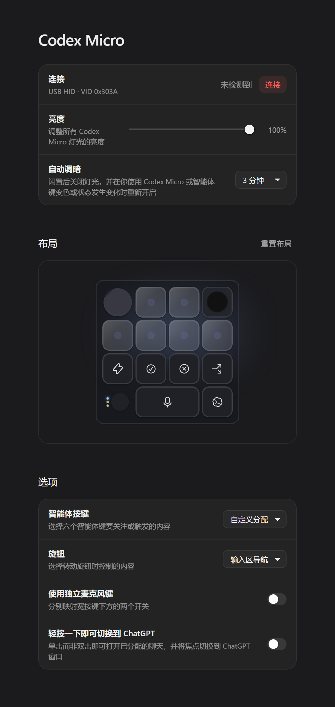
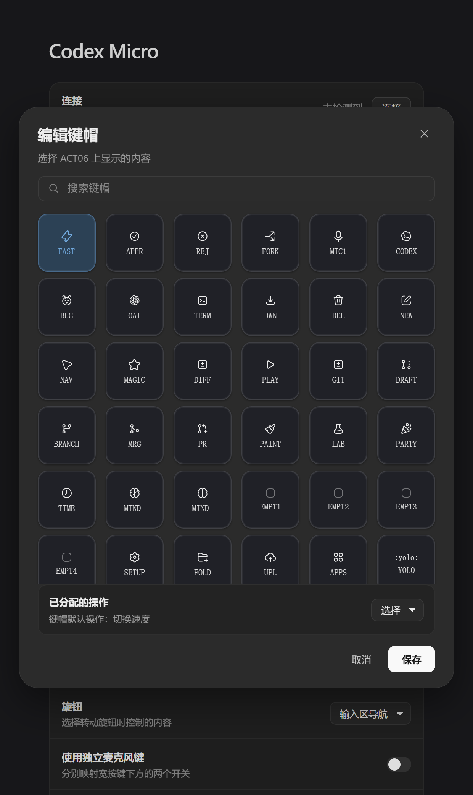

# dsh-micro

DeepSeek Harness 插件：把 **Work Louder「Codex Micro」HID 小键盘**（agent 宏键盘，本插件里称 **DSH Micro**）接成 Harness 的原生输入设备。
面板按 OpenAI Codex 桌面版的原版 Codex Micro 页面复刻：布局、键帽编辑器、智能体键分配、摇杆/旋钮编辑器、官方中文文案。
入口在**主页侧边栏**（全局面板行「DSH Micro」），面板在中间主区域打开，不再占用「设置」页。

「布局」里的设备卡是按原版**逐值复刻**的，不是目测：表面是正方形 4×4 网格、上限 15rem（每格 51.5px 见方），旋钮占两向 92%、摇杆是带边框的凹槽内含 72% 圆点、触摸垫 58%——这些数字来自原版 `app.asar`（`webview/assets/async/623696.*.js`、`121882.*.js`）里的 Tailwind 类。智能体键帽底色恒定，状态色是叠在磨砂底上的一层半透明灯光（40%），紫点只标位置、不随状态变色。

> 非官方社区项目：与 DeepSeek、OpenAI、Work Louder 均无隶属或背书关系；Codex Micro / Work Louder / OpenAI 是其各自权利人的商标。HID 协议为独立实现，未包含任何第三方专有代码。

## 安装

**不需要编译，不需要 `pnpm approve-builds`，不需要本机装 Node 工具链。**
（设备桥是个 `node` 子进程，用的是宿主自己带的运行时；在 Electron 宿主里它由 `ELECTRON_RUN_AS_NODE=1` 拉起，见「已知偏离」。）

在 Harness 里装（插件市场搜索 `dsh-micro`），或命令行：

```bash
dsh plugin --profile desktop add dsh-micro
```

安装完成后插件即可用：`cordis.patch.yml` 是纯 `insert`，市场会**热挂载**，无需重启整套 Harness。

| 项 | 要求 |
|---|---|
| DeepSeek Harness | `>= 0.2.1-rc.3`（清单里的 `engines.dsh` 由市场与安装闸门用来判定兼容性；官方 installer 本身不强制这个字段，所以老宿主装得上但可能跑不对）。已在 `0.2.1-rc.5` 与 `0.2.2-rc.1` 上验证：宿主的兼容闸门用 `semver.satisfies(..., { includePrerelease: true })` 判定，`0.2.2-rc.1` 这类预发布版本满足该范围，不需要 `allow-version` 豁免 |
| Node | `^22.19.0 || >= 24.0.0`（宿主自带的运行时，插件不下载 node） |
| 系统 | Windows 10+ / macOS / Linux（HID 运行时自带各平台预编译产物） |

**为什么装起来这么干净**：HID 运行时（node-hid）已经内联在本包里（`lib/vendor/`，MIT/BSD，见 `lib/vendor/NOTICE.md`），
所以本包**没有任何生产依赖**。这一点是刻意的 —— 带 `install` 脚本的依赖会让 pnpm 11 直接把整个 profile 安装判为失败
（`ERR_PNPM_IGNORED_BUILDS`，退出码 1），而 `@deepseek-ai/*` 这类宿主包一旦进了 `dependencies`，提升后会覆盖宿主自带的版本，
启动时报 `1 required plugin did not activate`。

## 功能

- **设备层**：独立 `node` 子进程 + 内置 HID 运行时，自动发现/重连（1/2/5/10 s 退避）；VID `0x303A`、usagePage `0xFF00`、PID 33632 / 33431 / 33432；读取固件/电量/层信息；断线时拒绝在途请求、拔线后立即释放接口。
- **动作模型**：绑定值是带前缀的动作字符串 —— `command:<id>`（命令）、`text:<文本>`、`url:<链接>`、`skill:<技能名>`、`ptt`（按住说话）、`noop`。无前缀的旧私有动词（`session.new`、`effort.up` 等）继续兼容。
- **39 款键帽，34 款有可执行动作**：键帽的默认动作直接由原版 `original` 描述推导；剩下 5 款是空白键（`EMPT1`–`EMPT5`，原版就是 `custom-shortcut`），装上后保持未绑定。找不到宿主能力时给出「此操作在此处不可用」提示，而不是静默失效。
- **连接管理（对齐原版 CodexMicroService）**：USB 与蓝牙 HID-over-GATT 都走同一条 node-hid 通道；**有线优先**，蓝牙连接期间插入 USB 会自动迁移（transport-handoff）；热插拔后按 **250 / 1000 / 3000 ms** 收敛重试，断线按 **1 / 2 / 5 / 10 s** 退避重连（成功或拓扑变化后归零）；连接尝试带 token，旧连接不会复活；状态覆盖 未检测到 / 已检测到 / 已连接 / 连接失败 / 连接中断 / 已重连 / 传输不可用（输入可用、灯光与电量暂停）。
- **硬件映射**：6 个智能体键、8 个命令键、宽 MIC 键、摇杆四方向、旋钮旋转/单击/长按。
- **旋钮四模式**：输入区导航（合成 `ComposerNavigation` / 方向键）、对话滚动（±160 px）、推理强度（顺时针降低、逆时针提高）、自定义（左右旋转/单击/长按四个手势独立绑定）；500 ms 长按在非自定义模式跳到设置页。
- **摇杆**：始终启用（没有开关），四扇区几何、死区 0.1 / 触发阈值 0.5、边沿触发、有输入区时 220 ms 延迟防误触。
- **摇杆 HUD 与触发动画**：推杆时**页面顶端居中**弹出原版同款 HUD（照抄原版 `CodexMicroJoystickHud` 的 `absolute top-14 left-1/2 -translate-x-1/2 w-[min(19rem,…)]`，隐藏态 `-translate-y-1 opacity-0`；DSH Micro 面板开着时画在面板顶部），方向图标、动作名、状态、进度条、`game-gesture` 环形进度，数值与过渡照抄原版（56px 圆盘、13px 位移、160ms `cubic-bezier(.2,.8,.2,1)`）。**游戏进行中不播摇杆 HUD**——原版摇杆 handler 在游戏期间直接 return。
- **旋钮脉冲动画**：每一格旋转点亮环形高光（`#8db5ff`）与右/左指示点（`#7da8ff`，220ms 后自动熄灭）。
- **首次连接导览**：三屏 onboarding（欢迎 / 智能体按键 + 状态图例 / 命令键），机身预览按原版 12 秒循环动画（智能体键 800ms 相位、命令键 700ms 相位、状态桶 3480/7440/11520ms、0.96s 交错淡入、6s 机身浮动），完成后写入本地标记；面板连接行可随时重新打开。
- **隐藏小游戏**：摇杆连续绕圈 1.9 圈（6 秒窗口、1 秒最长间隔、0.04 圈捕获、反向 0.02 圈取消），在**输入区上方**随机开启 `asteroids` / `brick-breaker` / `snake` 之一（原版就是挂在 composer 上的 `CodexMicroMiniGameComposer`，所以聊天页就能玩；DSH Micro 面板开着时画在面板里，两处不会同时跑）；192px 画布、原版常量与计分（10/20 分、combo ×1–5、食物/砖块取自本地化文案字符），AG00 在 asteroids 里开火。没有 composer、也没开面板时按原版语义**不触发**，不会在看不见的地方开一局；开打之后摇杆只喂游戏、不再弹摇杆 HUD。
- **智能体键**：四种来源（原版 §5.1）——`已置顶聊天` 按置顶顺序取前六个、`最近的聊天` 按最近活跃取前六个、`优先聊天` 按「等待审批/输入 → 工作中 → 未读 → 当前打开 → 其余，再按最近活跃」排序、`自定义分配` 只用你勾选的那份映射（切过去默认全不勾选，勾一个才映射一个）。单击就打开/切换该聊天（聊天绑定）或立即执行（键帽/命令/技能绑定）；350 ms 内同键再按、或窗口不在前台时单击，才额外把窗口提到前台（`单击即切换` 开关打开后单击总是提窗）；空绑定单击新建会话并绑定、一个聊天只占一个键、自动来源下禁止逐键编辑。
- **按住说话（语音输入，宽麦克风键固定为按住说话，没有模式开关）**：复用 DSH 的「语音输入」插件（`@deepseek-ai/dsh-experimental-voice-input-bundle`，SenseVoice 本地转写）。按下时**直接点击输入框里那个官方「听写」按钮**（按 `aria-label` 找它，标签走官方 voice-input 字典），所以展开动画、波形、麦克风权限提示、「正在录音…/识别中…」、「插入文字」全部是官方组件的原样行为；松开则点官方的「停止并识别」，转写结果由官方组件写进当前会话草稿。**找不到按钮就不开始录音**，只提示（插件没开 → 提示去开启；输入区不在前台 → 提示找不到听写按钮），不会静默失败、也不会退回自己录。上一次录完停在「未识别到语音/识别失败」提示行时，**再按一下就直接续接下一段**（内部点官方的「重新录音」），不需要先手动关掉提示。350 ms 双击闩锁状态机（轻按开始、再按结束、长按按住说话）；语音态会同步到设备灯效（录音海绿蛇形、转写白蛇形、完成白常亮 1.5 s），用户自己点按钮录音时也跟随。
- **键帽编辑器**：草稿式编辑（点「保存」才落盘，取消零副作用）、同名键帽自动换位、`text:` 动作带文本框、搜索含动作名、空结果提示。
- **灯光**：按原版 §4.6 的合成算法在**宿主半**完成（渲染端只上报宿主看不见的 UI 态：选中会话 / 未读 / 待审批 / 语音）。六键：选中或未读/待审批 → 呼吸，其余（含 working）→ 常亮，熄灭键发完整全 0 记录；色表与原版一致（working 蓝 `0x304FFE`、unread 绿 `0x00FF4C`、idle 白、awaiting 橙 `0xFF6D00`、error 红 `0xFF0033`）。氛围灯环只在「选中的 working 线程（蛇形）」「选中后 4 s 窗口」「语音态（录音海绿蛇形、处理白蛇形、完成白常亮）」亮；键帽背光只在选中 4 s 窗口内跟随选中色。亮度与自动调暗持久化，重连后自动重发，熄灯时 `rgbcfg` 与 `thstatus` 一起关。切换聊天会立刻重开这个 4 s 窗口（原版「切对话时的短暂动画」就是它，见 `.ref/notes/switch-animation.md`）：渲染端在切换动作里立即上报提示，能订阅到选中态时也订阅，1.5 s 轮询只作兜底。
- **多窗口安全**：localStorage 租约 + BroadcastChannel 选举主控窗口，硬件输入只执行一次。
- **模型工具 `dsh_micro`**：智能体可查询设备、点灯、发 RPC。
- **调试接口**：`/dsh-micro/state`、`/dsh-micro/diag`、`/dsh-micro/events`（SSE）、`/dsh-micro/action`。

## 使用

1. 插上 DSH Micro，关闭其它占用 HID 的程序（键盘重映射工具等）。
2. Harness 主页左侧边栏 →「DSH Micro」（面板在中间主区域打开，和 Plugins / Schedules 面板并列）。
3. 「布局」中：点键帽编辑；点智能体键分配聊天（需先切到「自定义分配」）；点摇杆/旋钮编辑手势；「重置布局」只恢复键帽，不动智能体键分配。
4. 硬件按键触发对应动作；旋钮长按进设置页；智能体键单击打开/切换聊天（切换瞬间会重开原版的 4 s 选中高亮）。
5. 麦克风键录音需要先开启 DSH 的「语音输入」插件（设置 → 插件 → 语音输入，SenseVoice 本地转写）；没开时按麦克风键会提示去开启。




## 出问题时

| 现象 | 说明 |
|---|---|
| 面板显示「驱动不可用」 | 内置 HID 运行时没能加载。行内有「重试」按钮；仍然失败就重装一次插件（`lib/vendor/` 可能被杀软或残缺的 git 检出破坏）。 |
| 显示「已检测到」但点「连接」没反应 | 接口被别的程序占着（键盘重映射、厂商驱动、另一个 Harness 窗口）。先退出它们。 |
| 点过「移除」后不再自动连 | 这是设计行为：移除会写入 `autoConnect: false` 并停止扫描，重启也不会自己连回来。点「连接」恢复。 |
| 面板显示「已连接，功能受限」 | 设备连上了，但灯光 RPC 没通（固件版本差异）。按键照常工作。 |
| 想看宿主这边的错误 | `%TEMP%/dsh-micro.log`（Windows）或 `$TMPDIR/dsh-micro.log`。 |

插件对宿主是**只增不减**的：`apply()` 全程有 try/catch，桥接进程崩溃有退避上限（连续 5 次快速退出后停止重试并上报状态），
监听器与子进程都在 `ctx.effect` 的 disposer 里释放。任何一半出问题都不应该拖垮 Harness 的启动。

## 目录结构

```
lib/index.js     宿主插件：工具、HTTP 路由、持久化、会话状态→灯效（SessionLighting）、桥接进程管理
lib/client.js    渲染端 bundle：侧边栏入口 + 主区域面板 + 硬件事件 → 动作的运行时
lib/bridge.cjs   HID 子进程：帧解析、请求队列、自动重连
lib/hid.cjs      HID 运行时加载器：内置副本 → 用户自装副本 → 明确降级
lib/vendor/      内联的 node-hid 运行时（MIT/BSD，见 NOTICE.md）；HID 传输与 JSON-RPC 方言是本仓库自己的独立实现，不含任何第三方专有代码
locale/          插件清单文案 + 面板文案字典（meta.title / meta.description + 434 条词条），en + zh
icon.svg         插件列表与设置页的图标
cordis.patch.yml bundle 叠加层（纯 insert，可热挂载）
test/            冒烟测试：面板渲染、运行时行为、设备层、降级启动、真机宿主
tools/           开发用工具：词条编译（`npm run i18n`）
```

## 遵循的 DSH 插件规范

清单里的每个字段都对应官方 `cordis-plugin-development` 技能与各包 README 的要求，不是照抄社区插件的写法：

| 要求 | 本插件的做法 |
|---|---|
| `dsh.bundle.patch` + 唯一 entry id | `cordis.patch.yml` 是纯 `insert`（`id: dsh-micro`），市场可热挂载；带 `config:` 的行只能重启生效 |
| 显示元数据 | `locale/{en,zh}.json` 提供 `meta.title` / `meta.description`；`exports` 暴露 `./locale/*.json` 与 `./icon` |
| 图标 | 原创 `icon.svg`（< 256 KiB），清单顶层 `icon` 字段指向它 |
| `dsh.manifestVersion` | `1` |
| 客户端加载时机 | `dsh.client.immediately: true`——面板不在设置页打开时才加载，键盘绑定必须随页面启动 |
| 客户端注入顺序 | `dsh.client.inject` 只列宿主真实存在的包（`immediately` 只排序激活，不改变解析） |
| 不重复打包宿主 | `dependencies` 为空；宿主包只由 profile 提供。原生模块（node-hid）内联在 `lib/vendor/`，不触发 pnpm 的 `strictDepBuilds` |
| 资源归 context 所有 | 宿主侧子进程 / 定时器 / HTTP 路由 / SSE 响应都在 `ctx.effect` 的 disposer 里释放；渲染端样式表同样注册为 effect |
| 样式只用主题令牌 | 面板容器、文字、边框、控件读 `--dsw-alias-*`（经 `--cm-*` 间接映射，令牌缺失时有回退）；键帽、旋钮、摇杆、状态灯属于设备渲染，保留字面色。`test/tokens.mjs` 断言每个引用都在宿主主题真实定义的 349 个令牌里——写错一个名字时浏览器会静默丢属性，渲染测试抓不到 |
| UI 文案走 locale 服务 | 全部 434 条文案（面板、按钮、状态、提示、手势说明、诊断日志）都经 `t()`；`ctx.locale.register("dsh-micro", { en, zh })` 注册扁平字典，取不到服务时回退内置中文。渲染端无裸中文字面量，`npm test` 会断言 |
| 不替换应用根 | 面板注册进主页侧边栏的两个座位：`sidebar.panellist`（行图标）与 `main`（面板页），两侧用同一个 id 关联；toast 由 `ToastHost` 在 slot 内渲染，不向 `document.body` 追加节点 |
| 不写组件外 DOM | **有例外**：composer 的文本插入 / 提交 / 滚动 / 导航要直接操作宿主输入区；摇杆 HUD / 隐藏小游戏要挂到输入区上方的浮层里（`react-dom/client` 单独 `createRoot` 到 `document.body` 下的固定容器）。都是规范明确不建议的做法，但没有可用替代，见「已知偏离」 |

### 已知偏离（及其原因）

官方 `cordis-plugin-development` 规范里有几条本插件做不到（外加两条需要写明的判断），都是**宿主没给入口**或**许可/依赖代价**的问题，而不是图省事。写在这里，是为了让下一个维护者知道这是判断，不是疏忽：

1. **操作宿主 composer**（`practices.md`：“Do not write DOM outside your component”）。键盘的文本插入、发送、滚动、输入区导航只能落在宿主输入框上：`0.2.1-rc.5` 没有“把文本放进草稿框”的 Host 入口，`ctx.remote` 的转发 allowlist 是宿主编译期写死的，`host.call` 只发给动态（运行时求值）插件——静态 bundle 的工厂拿到的只有 `require`，见 `dsh-cordis-client-runner` 的 `guardedSurface`。所以这层只能在 DOM 上做，并且刻意做得很窄：
   - 只认当前焦点元素和 `textarea` / `contenteditable`，命中不到就返回 `false`，动作变成「此操作在此处不可用」；
   - 焦点在面板自己（`.cm-root`）里时一律不动，避免把按键打进自己的控件；
   - 宿主改版导致选择器失效时是**功能降级**，不是崩溃。

2. **自建 HTTP/SSE 通道**。同上：静态 bundle 没有 `host.call`，`ctx.remote` 只转发固定事件表，设备状态没有现成投影。于是客户端通过 `/dsh-micro/{state,events,action}` 直连宿主半。写接口做了三道防护（`Sec-Fetch-Site` 非 same-origin 拒绝、无该头时校验 `Origin`/`X-Forwarded-Host`、只接受 `application/json`），并按 op 白名单执行；任意固件方法的转发**没有**暴露在这条通道上（面板从不调用它，只有模型工具走，且工具侧拦掉 bootloader/erase/reboot）。

3. **没有 `export const Config`**。规范建议可调项走 `Config` 以便在 `cordis.patch.yml` 里改。本插件的可调项（亮度、自动熄屏、旋钮模式…）是**运行时用户偏好**，在设置面板里改并立刻生效，不是部署配置；加 `Config` 需要 `@deepseek-ai/schemastery` 的 schema 对象，而这个包刻意保持零依赖——一旦解析不到，整个插件行激活失败，代价远大于收益。

4. **绑定与偏好写在 `~/.dsh/dsh-micro-bindings.json`**，而不是 `ctx.storageDomain`。宿主确实提供 `storageDomain`，但它要求 composition 里挂上 `storage` + 后端 + `storage-domain` 三行，desktop profile 不一定有；而这份数据在 `apply` 阶段就要同步读到（否则面板首帧是空的），一个可能缺席的异步服务换不掉一个原子写入的同步文件。文件本身做了三点保护：临时文件 + rename 的原子写、体积上限、读入时形状与版本校验（`version: 2`），坏文件按默认值重建而不是让插件启动失败。

5. **协议是按行为观测独立重写的，不是拷贝原版代码**。HID 帧格式、私有 JSON-RPC 方言、`v.oai.thstatus`/`v.oai.rgbcfg` 的短键、`host.focused_app`、重连与 50 ms 冷却这些事实，来自对设备实际收发报文和 `app.asar` 里公开可见行为的观测；实现（`lib/bridge.cjs`、`lib/hid.cjs`）是本仓库自己的代码，MIT。原版 Work Louder device kit 是 `UNLICENSED` 专有包，**没有**被内联或复制；如果后续想换成官方包，需要对方授权，并且那份包不能随 MIT 仓库分发。

6. **「提窗」只能请求，不能强制**。原版在主进程里 `showWindow({ stealFocus: true })`，是确定性的；渲染端只有 `window.focus()`，是否真的把窗口提到前台由 Electron/OS 决定（没有用户手势时可能被拒绝）。原版「窗口不在前台时单击就提窗」这一条按 `document.hasFocus()` 复现：页面失焦时单击会补一次 focus 请求，已经在前台时单击只切聊天——和原版主进程的判定一致。

7. **语音键会去点官方「听写」按钮，因此读了另一个插件的 DOM**（`ui-plugin.md` 要求别读别的插件的 DOM/样式/源码）。这是为了 1:1 复刻官方体验做的取舍：官方 voice-input 插件没有暴露「开始/停止」的公开接口，只有它自己的按钮组件，所以按下麦克风键时按 `aria-label`（用官方 `voice-input` 词条翻译，中英文都对）找到那个按钮并 `click()`，松开点「停止并识别」，动画/波形/权限提示/识别中/插入文字全由官方组件负责。**失败模式与防护**：找不到按钮就**不开启录音**，只提示「找不到输入框里的听写按钮」；插件没开则提示去开启；按钮被禁用（会话运行中）提示暂时不能录音；官方组件停在「未识别/失败」提示行时，下一次按下会直接点「重新录音」续接，不需要额外的关闭操作。任何 DOM 探测都有 try/catch，官方改结构只会让它降级成提示，不会抛错。已向上游的公开接口诉求记录在此，等 voice-input 暴露 actions 后即可删掉这段 DOM 路径。

8. **摇杆 HUD / 小游戏挂到宿主页面的浮层里**。原版 HUD 是页面顶端的 `absolute top-14 left-1/2`（`CodexMicroJoystickHud`），小游戏是 composer 位置的 `CodexMicroMiniGameComposer`；DSH 的插件只能往宿主给的 slot 里注册组件，没有「页面顶部」或「composer 上方」这种座位，所以浮层用宿主自带的静态模块 `react-dom/client`（web boot 的 `staticModules` 里有）单独 `createRoot` 到一个 `position:fixed`、`pointer-events:none` 的 `document.body` 子节点：HUD 固定在视口顶端居中（Windows 桌面下再加上 `--dsh-windows-titlebar-height`，和原版位于菜单栏下方一致），游戏按 composer 的 `getBoundingClientRect()` 贴到输入区上方。**防护**：拿不到 `react-dom/client` 就静默降级（面板里的 HUD/游戏仍可用）；浮层自身全部 `try/catch`，`ctx.effect` 的 disposer 里 `unmount` 并移除节点；面板可见时不渲染浮层，避免同一局游戏被两个画布各推一帧。同 §1，宿主改版导致的失效是功能降级，不是崩溃。

### 文案是怎么组织的

`t()` 的查找顺序是 **宿主 locale 服务 → 内置中文字典 → key 本身**。key 是扁平的点分路径（`editor.actionNoResults`、`catalog.approval.allow.label`），因为宿主是按 key 直接索引字典的，嵌套对象会让每条文案都退化成一个裸 key。

真源是 `tools/i18n-strings.mjs`（`key: [中文, English]`）。改完文案跑：

```bash
npm run i18n     # 编译进 lib/client.js，并重写 locale/{zh,en}.json
npm test         # 断言三份副本一致、英文不含中文、占位符两侧对齐
```

`npm test` 还会扫描 bundle，确认字典之外没有硬编码中文——漏掉一条就失败，不会悄悄只显示一种语言。

有一类文案必须留在模块级常量里（键帽表、旋钮手势表）：它们在 `apply` 绑定 locale 之前就求值了，直接调 `t()` 会被永久冻结成导入时的语言。这些表存的是 key，由渲染处翻译。

持久化文件：`~/.dsh/dsh-micro-bindings.json`（原子写：先写 `.tmp` 再 rename；读入前校验体积与形状）

```jsonc
{
  "version": 2,
  "bindings": { "ACT06": "FAST", "AG00": "session.open:0", "STICK_UP": "plan.toggle" },
  "overrides": { "FAST": "command:composer.toggleFastMode" },
  "agentSlots": ["sessionId|null", "...共 6 项"],
  "settings": { "brightness": 100, "autoOff": "3-minutes", "encoderMode": "composer-navigation",
                "agentSource": "recent", "splitMic": false, "singleTapAgentKeys": false,
                "voiceButtonMode": "push-to-talk", "joystickDisabled": false, "autoConnect": true }
}
```

0.1/0.2 的扁平映射文件会在读取时自动迁移。

为什么用子进程：Harness 跑在 Electron 内，原生模块 ABI 与预编译包可能不匹配，所以 HID 放在独立 `node` 进程中，
通过 stdin/stdout 的 JSON 行协议通信；子进程崩溃不会影响 Harness，父进程退出时子进程会释放接口自杀。

## 测试

```bash
npm install          # 只为 test/ 装 react + react-dom，运行时没有依赖
npm test             # 面板渲染 + 运行时 + 会话状态灯效模型 + 主题令牌 + 设备层 + 降级启动 + 字典一致性
npm run test:host    # 真机：连接、落盘、灯光写固件、agent-slots、重置语义、移除设备
```

`npm run test:host` 会先把 `HOME`/`USERPROFILE` 指向临时目录再启动，不会读写你真实的
`~/.dsh/dsh-micro-bindings.json`。直接用 `node test/host-smoke.mjs` 跑则会命中真实配置——
"移除设备"那步会把 `autoConnect` 写成 `false`，之后每次启动都连不上，看起来像驱动坏了。

`npm test` 全部在无设备的情况下也能跑（真在场时顺带验证枚举）。
`npm run test:host` 需要插着设备，且会读写 `~/.dsh`，建议用临时 HOME：

```bash
USERPROFILE=/tmp/cm-home npm run test:host
```

想验证「没有 HID 运行时」的降级路径：`DSH_MICRO_HID=off node test/degraded-smoke.mjs`。

## 协议

- 64 字节 HID 报文：`[0]=6, [1]=channel(2=RPC), [2]=len(≤61), [3..]=UTF-8 JSON`
- JSON-RPC 私有方言：`{id, method, params}`，**没有** `jsonrpc` 字段，id 0–998，单飞 + 50 ms 冷却
- 通知 `v.oai.hid`(k/act/ag)、`v.oai.rad`(a/d)；灯光 `v.oai.thstatus`、`v.oai.rgbcfg`；设备会反过来问前台应用 `host.focused_app`（`{appName,process,path}`，连接后立即上报并每 5 s 刷新，`DSH_MICRO_FOCUS_APP=off` 可关闭，设为其它值可改应用名）
- `device.status` → `version/profile_index/layer_index/battery/is_charging`

`act`：`0` 松开、`1` 按下、`2` 重复（仅旋钮）。按键必须处理 `0`，否则无法实现长按、双击与按住说话。

## 已知限制

- 宿主未暴露的命令（`git.*`、`toggleTerminal` 等）只会给出「此操作在此处不可用」，不会静默假装成功。
- 按住说话依赖宿主的语音服务（`voice` / `remote.voice` / `dictation`）；没有时不录音，只提示。
- **界面只有中英两套文案**。DSH 0.2.2 新增 de/es/fr/ja/pt/ru 后，面板在这 6 种语言下回落到英文（宿主语言链以 `en` 收尾）；麦克风键仍能工作——它按官方 `voice-input` 词条（`start`/`stop`/`cancel`/`discard`/`retryRecording`/`setupPrompt.trigger`）查找听写按钮，不依赖插件自己的语言。
- 命令面板的 182 个原版 commandId 只接入能在 Harness 落地的那部分。
- **浅色主题没有在真实浏览器里逐项目检过**。所有颜色都取自宿主令牌（`test/tokens.mjs` 守住），但对比度、间距、悬停态没有截图验证；这条不算通过，只是没有已知问题。

## License

MIT。内联的 node-hid 运行时为 MIT / BSD-3-Clause，见 `lib/vendor/NOTICE.md`。HID 传输层与灯光协议是本仓库的独立实现，不含第三方专有代码。
